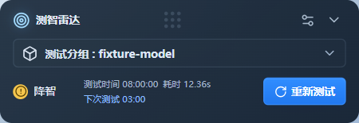
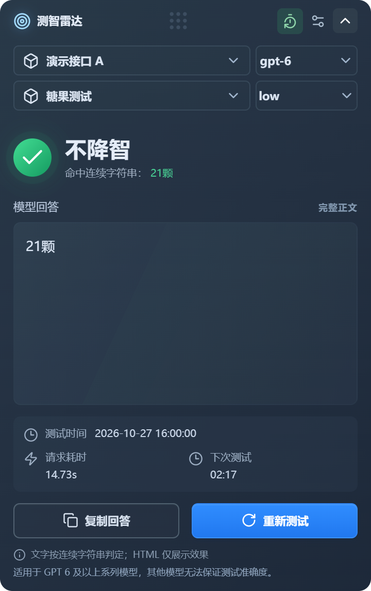
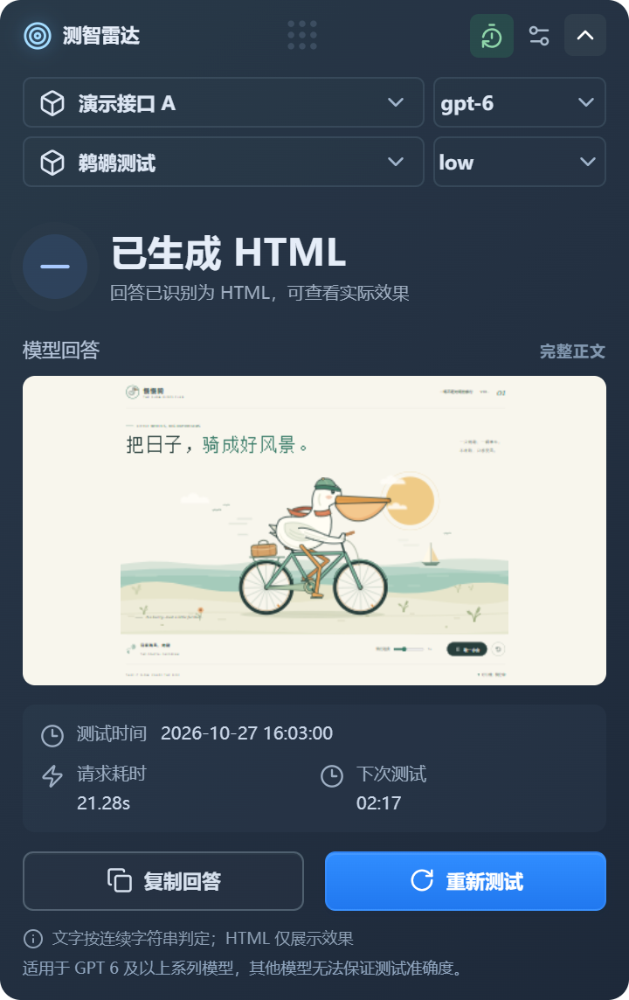
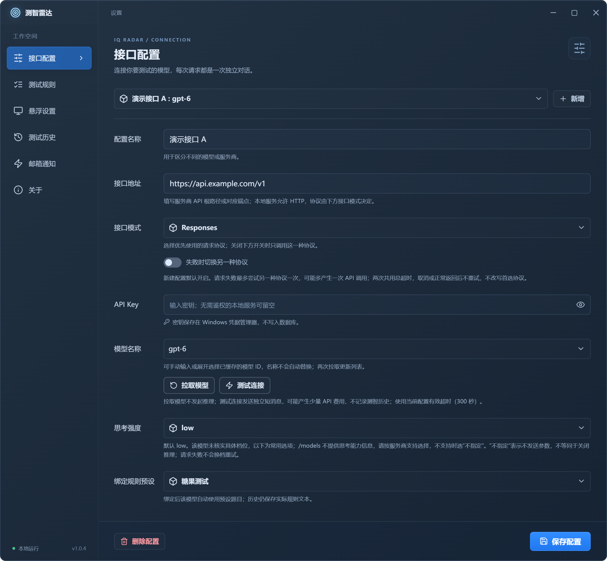
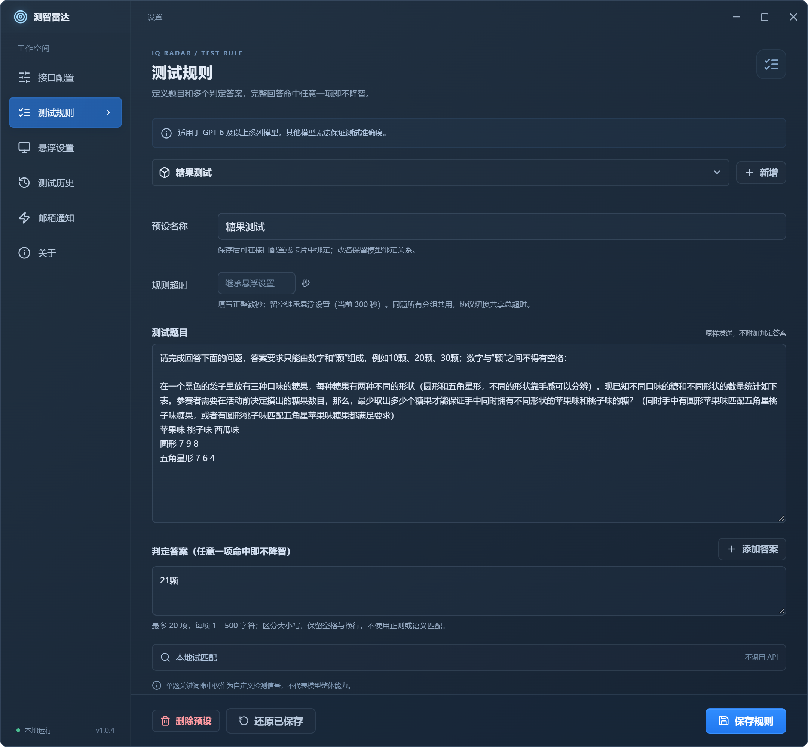
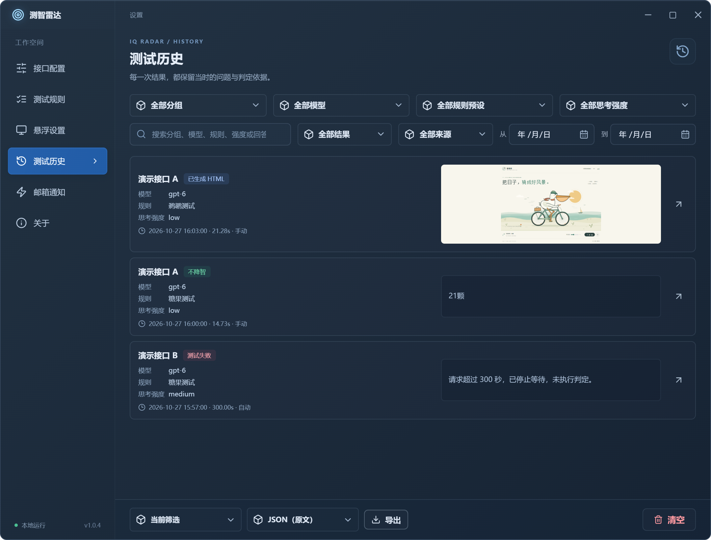
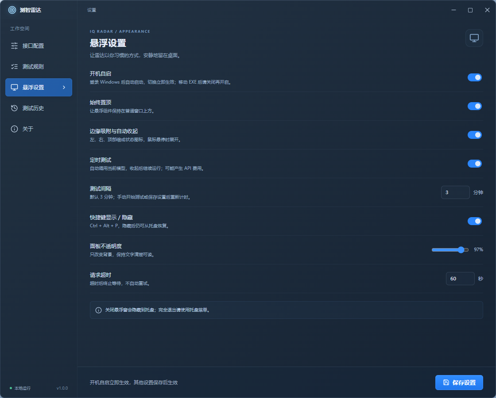
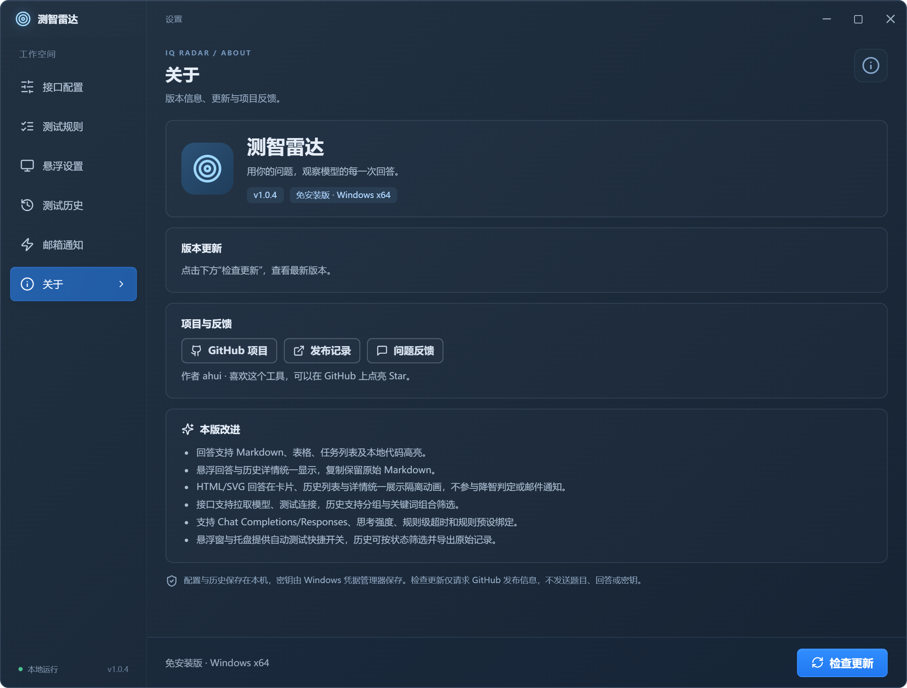

<div align="center">


# 测智雷达 · Model IQ Radar

### 用你的问题，观察模型的每一次回答

自定义测试题目、记录模型回答，在桌面悬浮窗中查看文字判定与 HTML / SVG 动画。基于 Tauri 2、Vue 3、TypeScript 和 Rust，支持 Windows 10 / 11 x64。

[](https://github.com/ahuiyuchuan/model-iq-radar/releases)
[](https://github.com/ahuiyuchuan/model-iq-radar/releases/latest)
[](https://tauri.app/)
[](https://github.com/ahuiyuchuan/model-iq-radar/releases)
[](LICENSE)

**[下载安装](#下载安装) · [界面预览](#界面预览) · [快速开始](#快速开始) · [功能特性](#功能特性) · [常见问题](#常见问题) · [使用手册](docs/USER_GUIDE.md) · [更新日志](CHANGELOG.md)**

</div>

## 为什么选择测智雷达？

- **题目与规则可控**：自带糖果、日本首相、鹈鹕测试，支持自定义预设；文字回答按 1—20 个判定答案中的任一连续字符串匹配。
- **随时切换，保留结果**：悬浮窗直接选择接口分组、模型、规则与思考强度；切回已有完整条件时恢复对应的最近保留记录。
- **文字与动画分别展示**：文字显示安全 Markdown；自动识别的 HTML / SVG 直接播放，点击放大，历史列表和详情共用相同预览。
- **按需持续监测**：手动测试、取消、定时测试和邮件通知；自动测试在当前测试结束后重新等待完整间隔。
- **配置留在本机**：SQLite 保存配置与历史，Windows 凭据管理器单独保存 API Key 和邮箱授权码。

> **适用范围：适用于 GPT 6 及以上系列模型，其他模型无法保证测试准确度。** 这是产品预设说明，尚无统计准确率验证。文字结果仅表示原始回答是否命中配置字符串，不代表模型综合能力，也不能据此证明服务商是否存在降智行为。HTML 只展示效果，不评价动画质量。

## 界面预览

以下图片由 **v1.0.4 Vue 组件**生成，本版沿用这些界面布局。接口与测试记录为虚构数据，HTML 使用用户提供的鹈鹕海岸骑行示例。图片不含账号凭据，用于展示界面，不代表实际模型测试或邮件投递结果；动画可在应用内播放。

|                                                  紧凑悬浮：两行快捷选择与最近结果                                                   |                                                展开回答：原文、耗时与自动倒计时                                                |
| :---------------------------------------------------------------------------------------------------------------------------------: | :----------------------------------------------------------------------------------------------------------------------------: |
|  |  |

<details open>
<summary><strong>HTML / SVG：直接播放，点击画面放大</strong></summary>



悬浮卡片、历史列表和历史详情使用相同的 HTML 预览与放大交互，点击画面后可放大查看：


</details>

<details>
<summary><strong>接口配置：协议、模型、思考强度与规则绑定</strong></summary>



</details>

<details>
<summary><strong>测试规则：命名预设、多答案与每题超时</strong></summary>



</details>

<details>
<summary><strong>测试历史：四项组合筛选与文字 / HTML 回答</strong></summary>



</details>

<details>
<summary><strong>悬浮设置：调度、保留范围与分类清空</strong></summary>



</details>

<details>
<summary><strong>关于：版本、项目链接与更新检查</strong></summary>



</details>

## 下载安装

当前正式版为 **v1.0.6**：[查看发布说明](https://github.com/ahuiyuchuan/model-iq-radar/releases/tag/v1.0.6) · **[下载 Windows x64 EXE](https://github.com/ahuiyuchuan/model-iq-radar/releases/download/v1.0.6/Model-IQ-Radar-v1.0.6-Windows-x64.exe)**。

下载后直接运行，无需安装或解压。系统需安装 [Microsoft Edge WebView2 Runtime](https://developer.microsoft.com/microsoft-edge/webview2/)；使用远程模型时需能访问配置的 API，费用由对应服务商收取。

更新时完全退出旧版后运行新版，配置、历史和系统凭据继续沿用，建议先备份完整应用数据目录。更换 EXE 路径后，已启用自启的用户应重新设置自启路径。GitHub 自动生成的 Source code 归档是源码，不是可执行程序。

本版主要更新：Responses 空前导兼容、双协议失败原文及 SSE 诊断、历史分页与搜索优化，以及更准确的邮箱通知说明。详情见 [v1.0.6 发布说明](docs/release-notes/v1.0.6-zh.md)。

## 快速开始

1. 打开“设置 → 接口配置”，填写分组名称、API 地址和 API Key。点击“拉取模型”后选择模型，或手动输入准确的模型 ID。
2. 选择接口模式、思考强度和绑定规则后保存。新建接口默认 **Responses、low、糖果测试**，并开启“失败时切换另一种协议”；已有配置保留原选择。**开启回退可能产生第二次请求和额外费用；希望只调用所选协议时请关闭回退。**
3. 在“测试规则”调整题目、判定答案及规则超时。超时填写正整数秒，留空继承“悬浮设置”的全局值，默认 **300 秒**；300 不是可填写范围的上限。
4. 回到悬浮窗，点击“开始测试”或“重新测试”。右上角箭头展开 / 收起回答；两行选择器可直接切换分组、模型、规则和思考强度，切换本身不请求模型。
5. 按需控制自动测试。默认启用、间隔 **3 分钟**，当前测试结算后才重新计时；运行中显示“本次结束后计时”，不积压补跑。邮箱通知默认关闭，需要另行配置并保存。

接口地址示例为 `https://api.example.com/v1`，也可填写完整的 `/chat/completions` 或 `/responses` 路径；程序不会猜测或额外添加 `/v1`。远程接口须使用 HTTPS，仅本机服务允许 HTTP。模型拉取和“测试连接”各自独立，连接测试可能计费，但不执行测智判定、不写测试历史。

### 如何理解结果

| 状态              | 含义                                                                   |
| ----------------- | ---------------------------------------------------------------------- |
| 不降智            | 完整、非空的最终文字原文命中任一配置答案，区分大小写，保留空格和换行。 |
| 降智              | 有效的最终文字原文未命中配置答案，不代表模型综合能力结论。             |
| 已生成 HTML       | 自动识别 HTML / SVG，仅展示效果，不判断降智，也不提供人工标记。        |
| 测试失败 / 已取消 | 网络、协议、空响应、截断、超限、超时或取消等情况，不作为降智判定。     |
| 待重新测试        | 当前完整条件没有可确认匹配的保留记录，旧结论不作为当前结果。           |

新建接口默认选择糖果测试，判定答案为 `21颗`。日本首相测试保留记忆问答，内置答案为 `高市早苗`；鹈鹕测试要求生成黑天鹅骑自行车的 HTML / SVG 动画。三套内置题目、自定义规则及升级兼容细节见[使用手册](docs/USER_GUIDE.md)。题目中的“禁止联网、读取文件”约束被测模型，客户端仍需联网调用远程 API，无法核实服务商内部是否启用了隐藏工具。

## 功能特性

| 模块           | 当前功能                                                                                                             |
| -------------- | -------------------------------------------------------------------------------------------------------------------- |
| 接口与模型     | 多接口分组，持久模型目录，可手填模型；目录为空时悬浮窗显示拉取按钮，有目录时隐藏。                                   |
| 协议与思考强度 | Responses / Chat Completions，可选失败回退；`low / medium / high / xhigh / 不指定`，不自动换档。                     |
| 测试规则       | 命名预设、1—20 个文字判定答案、规则绑定与每题超时；留空继承全局超时。                                                |
| 调度与桌面     | 手动 / 自动测试、取消、结算后计时；紧凑 / 展开视图，左 / 右 / 顶部吸边、悬停恢复与托盘。                             |
| 结果恢复       | 同一接口分组、相同完整条件优先恢复最近保留的回答、状态、时间和耗时；不跳过最近失败或取消。                           |
| 回答展示       | 安全 Markdown；HTML / SVG 自动识别、实时动画、点击放大、Escape 返回；三处共用样式与交互。                            |
| 历史管理       | 四项条件及状态、来源、日期筛选；摘要索引、每页 10 条正文和 250ms 搜索防抖，详情/复制保留原文，导出覆盖全部筛选结果。 |
| 邮箱通知       | TLS / STARTTLS，降智 / 恢复 / 测试失败事件；独立持久状态，手动与自动测试均适用。                                     |
| 数据与草稿     | 不含凭据的配置备份、导入预览；切换 / 关闭前保存、放弃或取消；五类数据可选清空并恢复初始状态。                        |
| 响应诊断       | 两协议失败原文及 SSE 事件定位，另存成功/失败传输时间线；本地有界留存，不额外请求、不自动上传。                       |
| 系统与更新     | 置顶、透明度、吸边、当前用户开机自启；正式 Release 更新检查与下载入口，无自动安装。                                  |

### HTML / SVG 预览

- 自动识别明确的 HTML / HTM / SVG 代码块、完整文档或独立布局片段；多个片段独立切换。普通文字和行内标签示例继续按安全 Markdown 显示。
- 悬浮卡片、历史列表和详情直接播放保存的 HTML，点击画面页内放大，关闭或 Escape 返回；使用同一宿主，不创建原生预览子窗口。历史仅可见行运行，离开后释放；不保存截图。
- 按首帧实际内容去除外围留白并等比居中，保留作品内部布局；无法可靠测量时沿用完整画布。加载动画最少显示 **300 毫秒**，慢加载等待实际首帧，**12 秒**未就绪显示错误并提供重载。
- 有效 HTML 不产生降智 / 恢复结论、不发邮件，也不清除此前文字降智状态；识别出的部分 HTML 发生请求错误时同样不发邮件。错误或取消的部分源码不运行；预览失败不改判为降智。
- 页面在沙箱 iframe 中运行，阻止联网、IPC、弹窗、下载和外部导航；依赖 CDN 或在线资源的作品可能不完整。iframe 共享浏览器资源，不提供独立进程的 CPU / 内存硬隔离。

查看、放大、重载或切换历史只使用已保存回答，不再次调用模型。复制与导出保留完整原文，旧历史不重新判定、不补发邮件。资源上限及安全边界见[使用手册](docs/USER_GUIDE.md)。

### 切换条件与历史

例如先测糖果、再测鹈鹕，切回糖果即可恢复原糖果记录。匹配范围包含接口分组、规范化地址、模型、凭据修订、题目及答案、协议 / 回退策略、思考强度和有效超时；单纯改名或调整外观不影响匹配。

同条件最近一次是失败或取消时，展示该次记录；其他分组不串用。没有精确匹配或旧记录缺少条件摘要时，继续展示同分组最近保留的回答、HTML、时间和耗时，标注“上次回答 · 当次协议”及“待重新测试”，不沿用旧结论；失败或取消记录中的部分 HTML 不运行。历史已清空则无可展示记录。切换查看不请求模型、不改写历史，也不发送邮件。

### 邮箱通知

SMTP 默认填 `smtp.qq.com`、465 / TLS，**通知总开关默认关闭**。支持 TLS / STARTTLS 和最多 10 个收件人；需填写发件账户、服务授权码及收件人并保存，“发送测试邮件”只验证当前草稿。

总开关及对应事件开启后，每次文字降智、每次非 HTML 测试失败均尝试发信；同一模型分组从降智恢复为不降智时发送恢复邮件，首次及持续通过不发送恢复。手动 / 自动、跨规则和并发场景均适用；取消和 HTML 不通知。发送失败不影响测试结果，不自动重试或补发，错误可在邮箱设置中查看。

### 流式响应与本地诊断

Responses 和 Chat Completions 均主动发送 `stream: true`，界面仍在完整响应后展示结果。Responses 从唯一 `response.completed` 提取最终助手正文；Chat Completions 按同一响应的 `delta.content` 还原正文，并核对 `finish_reason: stop` 与 `[DONE]`，不混入推理、工具参数或其他候选。网关实际返回完整 JSON 时沿用原解析，不另发非流式请求。仍需在总超时内读到 EOF，整段响应不超过 **2 MiB**；中断、超限、损坏、取消等情况不判成功。

v1.0.6 对 Responses 增加空前导兼容：仅在前导生命周期、空消息及空文本事件全部通过结构/关联校验时，允许一次新的 `response.created` 切换 ID；任何语义输出、未知结构、终态或第二次切换均不适用。Chat 暂无失败原文，仍严格拒绝 ID 变化，补齐诊断后再依据真实证据处理；不降低思考强度或改变回退设置。

两种协议正式测试的语法、结构、读取或其他响应验证失败，会尽力保存本次已收到的字节到：

```text
%APPDATA%\com.ahui.model-probe\response-diagnostics
```

文件以 `responses-` 或 `chat_completions-` 加 UTC 时间与 UUID 配对为 `.json` 和 `.body.bin`，原始响应诊断格式 3 区分 JSON 语法位置与 `sse_error` 的原因、事件序号/类型及预期/实际 ID。记录 HTTP、Content-Type、请求编号、收存字节数及完整/截断标志；正文最多 2 MiB，两协议共留存 **20 组**。HTTP 拒绝不为诊断继续读正文，无字节、凭据回显或写入失败时明确标注省略；未收到响应头仅有 transport。原文不改写，分享前请检查敏感内容。

诊断不自动上传，队列满或落盘失败不覆盖原测试错误、不阻止历史结算；程序退出时不保证文件已写完。普通历史清空不删除此目录。准确采集范围、字段与获取步骤见[使用手册](docs/USER_GUIDE.md#responses-sse-兼容与本地响应诊断)。

该目录的 `transport` 子目录另存两种协议每次正式测试尝试的脱敏错误链与时间线，包括失败和成功对照，覆盖收到响应头之前的连接失败。独立最多保留 20 份、每份 64 KiB，不保存题目、回答、接口地址或凭据。取证步骤见[本地传输诊断](docs/USER_GUIDE.md#本地传输诊断)。

传输诊断格式 2 记录实际 `request_stream: true`；v1.0.6 正式标记为 `sse_empty_prelude`，此前的 `dual_protocol_stream` 和 `sse_empty_prelude_diagnostic_beta` 等历史文件原样保留。流式仍可能受到中转缓冲或其他断连限制，客户端日志不能确定中转内部断链节点。协议及回退开关继续沿用现有配置；关闭回退只有一次协议尝试，开启后请求错误至多尝试另一协议一次并可能额外计费，两次共用原总期限。

## 常见问题

<details>
<summary><strong>为什么看起来回答包含答案，仍判定为降智？</strong></summary>

文字判定使用完整原文中的连续字符串，不做语义、正则或 Markdown 去标记。例如 `**高市**早苗` 视觉上连续，但原文不包含 `高市早苗`；大小写、空格和换行也影响匹配。Markdown 只改变显示，保存、复制和判定使用同一原文；HTML 自动识别后走独立效果展示。

</details>

<details>
<summary><strong>拉取模型失败，能否继续测试？</strong></summary>

可以手动填写准确的模型 ID。部分服务不提供 `/models`，成功拉取的目录会保存在本机，后续拉取失败保留旧目录；地址或凭据变化后需要重新拉取。目录只是候选列表，不保证模型可调用；“测试连接”会发送独立短消息，可能计费，但不写测智历史、不重置自动周期。

</details>

<details>
<summary><strong>数据存在哪里？如何迁移或降级？</strong></summary>

配置与历史位于 `%APPDATA%\com.ahui.model-probe\probe.db`，API Key 和邮箱授权码在 Windows 凭据管理器；免安装不等于数据随 EXE 保存。迁移前先备份完整数据目录，配置可通过设置导出 / 导入，历史单独导出；配置备份不含凭据，新电脑需要重新填写，邮箱导入后关闭。

当前数据库 schema 与配置备份均为 v3，支持读取 v1—v3 备份。v1.0.3—v1.0.6 使用相同数据格式，退出程序后可更换对应 EXE；降到更早数据格式的版本须恢复与之匹配的完整数据备份。已经清理的历史和诊断不会因降级恢复，已发邮件无法撤回。详细容量及兼容限制见使用手册。

</details>

<details>
<summary><strong>历史保留与“清除所有数据”有什么区别？</strong></summary>

默认保留最近 **500 条**；可设置最多 5000 条及 1—3650 天，另有 128 MiB 历史 JSON 正文上限，各限制同时生效。缩短保留范围会先预览并确认，清理后 SQLite 文件不保证立即缩小。

“恢复所有设置”和“清除所有数据”按相同规则工作：选择接口、规则、悬浮设置、历史、邮箱中的分类，可全选；最终确认后立即清空所选分类并恢复初始状态。接口 / 邮箱类别包含对应系统凭据，未勾选类别保留。历史页的普通“清空”保留通知恢复依据；分类清空历史会同时重置该依据。操作范围见使用手册，清空前请备份。

</details>

<details>
<summary><strong>关闭窗口、自启和检查更新分别怎样工作？</strong></summary>

关闭悬浮窗会隐藏到托盘，自动测试继续；通过托盘恢复或完全退出。自启只作用于当前 Windows 用户，指向当前 EXE 完整路径，移动 / 重命名后请重新设置。

更新检查在启动时执行一次，随后每次结束等待一小时；后台静默，不补跑、不自动下载或安装。“关于”页可手动检查并查看反馈，新版本通过系统浏览器下载。同版本的不同构建不互相提示升级。

</details>

## 开发与贡献

欢迎提交 [Issue](https://github.com/ahuiyuchuan/model-iq-radar/issues) 或 Pull Request。开发依赖、构建与验证边界见 [CONTRIBUTING.md](CONTRIBUTING.md) 和 [VALIDATION.md](VALIDATION.md)。反馈请使用虚构或脱敏内容，不提交 API Key、数据库、授权码或未经检查的原始诊断。

README 图片由[独立生成脚本](scripts/generate_readme_screenshots.mjs)配合[虚构数据桥接](scripts/readme-preview-bridge.ts)生成；使用当前组件，只监听本机随机端口并拦截远程请求，不启动桌面应用、不访问真实模型或 SMTP。脚本依赖和运行方式见文件注释，不属于生产入口。

**技术栈**：Tauri 2 · Vue 3 · TypeScript · Rust · SQLite · Windows 凭据管理器。

## 致谢

[CC Switch](https://github.com/farion1231/cc-switch) 的模型列表交互、关于页内容元素，以及 README 和 Release 组织方式为本项目提供了参考。本项目的功能范围、品牌和发布内容独立维护；未复制其赞助商、下载平台或用户数据。

第三方依赖许可证见 [THIRD_PARTY_NOTICES.md](THIRD_PARTY_NOTICES.md)。

## License

Copyright © 2026 ahui。项目采用 **GNU General Public License v3.0 only（GPL-3.0-only）**，完整条款见 [LICENSE](LICENSE)。第三方依赖保留各自许可证。
